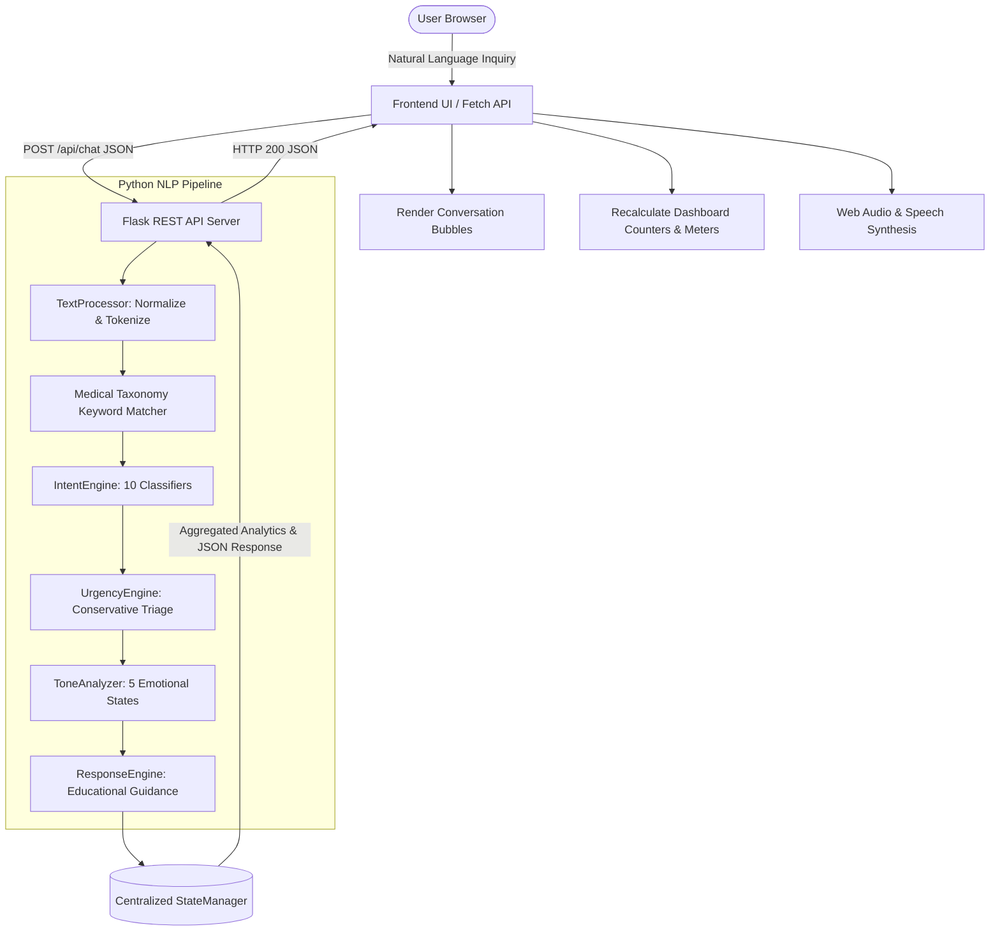
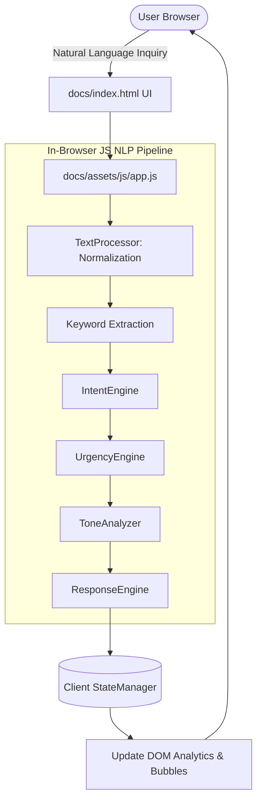

# MedQuery — Healthcare Question & Symptom Guidance Assistant

> **Tagline:** "Describe. Understand. Get Guidance."  
> **Subject:** Text, Speech and Analysis (Healthcare NLP Chatbot)  
> **Stack:** Python 3.13, Flask 3.1, Vanilla JavaScript (ES6+), HTML5, CSS3, Web Speech API, Web Audio API

[](#testing)
[](#technology-stack)
[](#technology-stack)
[](#live-demo)
[](#license)

---

## 🌐 Live Demo

- **GitHub Pages Static Demonstration:** [Launch MedQuery Live Demo](https://roshaan7.github.io/MedQuery/)  
  *(Replace with your actual GitHub username and repository URL after pushing)*

> **Architectural Notice:**  
> GitHub Pages serves static client files (HTML, CSS, JavaScript). Because GitHub Pages cannot execute Python/Flask server environments, MedQuery provides **both**:
> 1. **Complete Python + Flask Backend Application:** The primary implementation featuring the modular Python NLP pipeline, centralized session state, REST API, and automated test suite.
> 2. **GitHub Pages Static Demonstration (`docs/`):** An in-browser port of the NLP engine running client-side in Vanilla JavaScript with identical triage logic, live dynamic analytics, Web Speech voice dictation, and speech synthesis.

---

## 📑 Table of Contents

1. [Project Overview](#project-overview)
2. [Problem Statement & Purpose](#problem-statement--purpose)
3. [Core Feature Groups](#core-feature-groups)
4. [Text, Speech and Analysis (TSA) Concepts](#text-speech-and-analysis-tsa-concepts)
5. [Architecture & Workflow](#architecture--workflow)
   - [Full Flask Application Architecture](#full-flask-application-architecture)
   - [GitHub Pages Static Demo Architecture](#github-pages-static-demo-architecture)
6. [Technology Stack](#technology-stack)
7. [Project Directory Structure](#project-directory-structure)
8. [Backend REST API Specification](#backend-rest-api-specification)
9. [Installation & Setup](#installation--setup)
10. [Running the Application](#running-the-application)
11. [Automated Testing Suite](#automated-testing-suite)
12. [Computational Complexity Analysis](#computational-complexity-analysis)
13. [Healthcare Safety & Disclaimer](#healthcare-safety--disclaimer)
14. [GitHub Pages Deployment Instructions](#github-pages-deployment-instructions)
15. [Limitations & Future Roadmap](#limitations--future-roadmap)

---

## 1. Project Overview

**MedQuery** is an educational healthcare conversational assistant that allows users to express health inquiries, symptom descriptions, and wellness questions in natural language.

The application analyzes user text to detect:
- Likely health intent across 10 clinical domains
- Clinical keywords and symptom taxonomy terms
- Conservative urgency triage indicators (Routine, Needs Attention, Urgent)
- Emotional tone and affective sentiment (Calm, Concerned, Frustrated, Positive, Neutral)
- Evidence-based educational guidance and actionable next steps

**MedQuery is an educational assistant. It strictly does not diagnose diseases, prescribe medication, or claim clinical certainty.**

---

## 2. Problem Statement & Purpose

When individuals experience unexpected symptoms or seek health guidance online, they frequently encounter two extremes:
1. **Opaque Medical Search Engines:** Resulting in severe health anxiety ("cyberchondria") by surfacing alarming, worst-case diagnoses for minor complaints.
2. **Generic Black-Box LLMs:** Prone to hallucinating medication dosages or failing to flag emergency situations clearly.

**MedQuery addresses this gap through an honest, rule-based healthcare NLP pipeline:**
- Provides conservative, deterministic triage warnings for critical red-flag symptoms.
- Breaks down every stage of text analysis transparently via an interactive NLP Inspector.
- Calculates dynamic session analytics across all turns with zero hardcoded metrics.
- Integrates browser-native Speech Recognition (dictation) and Speech Synthesis (read aloud) for accessibility.

---

## 3. Core Feature Groups

MedQuery is structured around **7 comprehensive feature groups**:

### Feature 1 — Healthcare Conversational Assistant
- Users input natural-language health queries (e.g., *"I have had a throbbing headache and felt exhausted for two days"*).
- Returns empathetic, safety-compliant educational responses with evidence-based next steps.
- Native **Speech-to-Text (STT)** voice dictation and **Text-to-Speech (TTS)** voice read-aloud.

### Feature 2 — Intent Classification
- Evaluates text across **10 structured healthcare intents**:
  1. `emergency_concern`: Acute, life-threatening red flags
  2. `symptom_information`: Inquiries regarding physical symptoms
  3. `medication_information`: General pharmacology and medication questions
  4. `nutrition`: Diet, macronutrients, calories, hydration
  5. `sleep`: Circadian rhythm, insomnia, sleep hygiene
  6. `exercise`: Physical fitness, cardio, stretching, mobility
  7. `mental_wellness`: Stress regulation, anxiety, mindfulness
  8. `preventive_care`: Immunizations, checkups, screenings
  9. `general_health`: Vital signs, body physiology, wellness
  10. `unknown`: Non-medical or generic queries
- Employs weighted rule-matching to produce a normalized confidence score (0.0 to 1.0).

### Feature 3 — Symptom & Health Keyword Extraction
- Normalizes colloquial input and expands medical abbreviations (`bp` → `blood pressure`, `hr` → `heart rate`, `dr` → `doctor`).
- Matches single-word and multi-word clinical phrases against a categorized medical taxonomy (`symptom`, `lifestyle`, `clinical`, `mental_health`).
- Highlights detected terms in both conversational message cards and analytics panels.

### Feature 4 — Conservative Urgency Triage
- Assigns messages to an educational triage level:
  - 🟢 **Routine:** General wellness, lifestyle, and minor transient discomfort.
  - 🟡 **Needs Attention:** Moderate, worsening, or persistent symptoms requiring physician consultation.
  - 🔴 **Urgent:** Life-threatening red flags (crushing chest pain, shortness of breath, sudden numbness, severe bleeding) prompting immediate emergency directives.

### Feature 5 — Affective Sentiment & Tone Analysis
- Evaluates user emotion across 5 emotional states:
  - `Concerned`: Worry, heightened anxiety, or acute distress.
  - `Frustrated`: Exhaustion with persistent symptoms or chronic discomfort.
  - `Calm`: Inquisitive, structured, and measured inquiry.
  - `Positive`: Optimism, recovery progress, or healthy habit adoption.
  - `Neutral`: Factual, objective medical query.

### Feature 6 — Dynamic Healthcare Conversation Analytics
- Real-time session dashboard aggregated directly from centralized runtime state:
  - Total exchanges, user queries, assistant replies
  - Current urgency triage and detected emotional tone
  - Primary detected intent and model confidence
  - Intent distribution percentage meters
  - Urgency breakdown (Routine, Needs Attention, Urgent)
  - Emotional tone breakdown
  - Frequent health keyword cloud with live frequency counts
  - **Zero hardcoded values:** All metrics recalculate dynamically on every exchange.

### Feature 7 — Conversation & Clinical Analysis Management
- Multi-turn conversation history stream with chronological message threading.
- Interactive **NLP Pipeline Inspector Modal** visualizing raw text, tokenization, stop-word removal, taxonomy matches, and triage rules.
- **Sample Demo Restoration:** Populates 4 multi-turn clinical interactions across distinct intents and urgency tiers.
- **Clear Conversation:** Safely resets runtime state and analytics with a confirmation dialog.
- **Printable Clinical Summary:** Generates an A4-optimized, professional clinical consultation report (`window.print()`).

---

## 4. Text, Speech and Analysis (TSA) Concepts

MedQuery directly applies core computer science principles from the **Text, Speech and Analysis** curriculum:

| TSA Concept | Implementation in MedQuery |
|---|---|
| **Text Normalization** | Lowercasing, whitespace collapse, punctuation handling, and regex-based medical abbreviation expansion. |
| **Tokenization** | Word-boundary token segmentation preserving hyphenated medical terms (`x-ray`, `deep-sleep`). |
| **Stop-Word Filtering** | Filtering non-informative English stop words while retaining critical health modifiers (`not`, `severe`, `chest`, `sudden`). |
| **Information Extraction (IE)** | Longest-match greedy substring search matching multi-word medical entities (`shortness of breath`, `blood pressure`). |
| **Intent Classification** | Weighted lexicon scoring combined with regex sentence pattern matching and confidence calibration. |
| **Triage Heuristics** | Conservative risk-priority triage giving absolute precedence to acute emergency red flags. |
| **Sentiment Analysis** | Affective lexicon parsing detecting clinical anxiety, frustration, and recovery positivity. |
| **Speech-to-Text (STT)** | Voice dictation via browser `SpeechRecognition` / `webkitSpeechRecognition` API. |
| **Text-to-Speech (TTS)** | Speech synthesis via `window.speechSynthesis` for audibly rendering clinical guidance. |
| **Web Audio Synthesis** | Algorithmic sine and triangle wave audio pulses for interactive auditory feedback. |

---

## 5. Architecture & Workflow

### Full Flask Application Architecture



### GitHub Pages Static Demo Architecture



---

## 6. Technology Stack

- **Backend:** Python 3.10+ (Tested on Python 3.13), Flask 3.1.3
- **Frontend:** HTML5, CSS3 (Custom medical design system, CSS Grid/Flexbox), Vanilla JavaScript (ES6+)
- **Speech Technologies:** Web Speech API (`SpeechRecognition` for voice input, `SpeechSynthesis` for read-aloud)
- **Audio Feedback:** Web Audio API (Synthesized clinical sound effects)
- **Protocol:** HTTP/1.1 REST API, JSON, Fetch API
- **Testing:** Python `unittest` framework (50 automated unit, API, and integration tests)
- **Deployment:** GitHub Pages (Static demonstration via GitHub Actions), WSGI/Gunicorn compatible (Flask server)

---

## 7. Project Directory Structure

```
MedQuery/
├── app.py                      # Flask REST API server and routing
├── requirements.txt            # Python dependencies (Flask >= 3.0.0)
├── README.md                   # Comprehensive project documentation
├── .gitignore                  # Git ignore rules (including tests and caches)
│
├── services/                   # Modular Python NLP Pipeline
│   ├── __init__.py             # Services package initializer
│   ├── text_processor.py       # Normalization, abbreviation expansion, keyword extraction
│   ├── intent_engine.py        # Rule-based intent classifier with confidence scoring
│   ├── urgency_engine.py       # 3-tier conservative urgency triage engine
│   ├── tone_analyzer.py        # Emotional sentiment analyzer (5 states)
│   ├── response_engine.py      # Safe educational guidance generator & disclaimers
│   ├── state_manager.py        # Centralized in-memory session state & analytics
│   └── pipeline.py             # End-to-end NLP pipeline coordinator
│
├── templates/
│   └── index.html              # Jinja2 template for Flask single-page application
│
├── static/
│   ├── css/
│   │   └── style.css           # Clinical CSS stylesheet with ECG animations & print layout
│   └── js/
│       └── app.js              # Frontend controller connecting Fetch API & Web Speech
│
├── docs/                       # GitHub Pages Static Demonstration
│   ├── index.html              # Standalone demonstration entry point
│   └── assets/
│       ├── css/
│       │   └── style.css       # Relative-path demonstration stylesheet
│       └── js/
│           ├── nlp-engine.js   # Client-side JavaScript port of the NLP Pipeline
│           └── app.js          # In-browser application controller
│
├── .github/
│   └── workflows/
│       └── pages.yml           # GitHub Actions workflow for Pages deployment
│
└── tests/                      # Automated Test Suite (50 Tests)
    ├── __init__.py             # Tests package initializer
    ├── test_nlp.py             # Unit tests for preprocessing, intent, urgency, tone
    ├── test_api.py             # REST API contract and status code tests
    └── test_integration.py     # End-to-end multi-turn conversation and analytics tests
```

---

## 8. Backend REST API Specification

All endpoints communicate using standard JSON formatting.

| Method | Endpoint | Description | Request Body | Response Status |
|---|---|---|---|---|
| `GET` | `/` | Serves web application | None | `200 OK` (HTML) |
| `GET` | `/api/health` | Health & status check | None | `200 OK` |
| `POST` | `/api/chat` | Main conversational endpoint | `{"message": "..."}` | `200 OK` / `400 Bad Request` |
| `POST` | `/api/analyze` | NLP analysis preview (no state change) | `{"message": "..."}` | `200 OK` / `400 Bad Request` |
| `GET` | `/api/dashboard` | Dynamically calculated analytics | None | `200 OK` |
| `GET` | `/api/conversation` | Full message history | None | `200 OK` |
| `POST` | `/api/conversation/clear` | Resets conversation state | None | `200 OK` |
| `POST` | `/api/demo` | Restores 4 sample interactions | None | `200 OK` |

### Sample POST `/api/chat` Request & Response

**Request:**
```json
{
  "message": "I have had a throbbing headache and feel tired for two days."
}
```

**Response:**
```json
{
  "reply": "I understand you may be feeling concerned or uncomfortable. Symptoms such as those you described can arise from various common causes...\n\nIdentified health terms: 'headache', 'tiredness'.",
  "title": "Educational Symptom Overview",
  "intent": "symptom_information",
  "confidence": 0.83,
  "urgency": "Needs Attention",
  "urgency_rationale": "Symptom reported. Monitor progression and seek clinical advice if symptoms worsen or persist.",
  "tone": "Concerned",
  "tone_rationale": "Phrasing reflects worry, heightened apprehension, or health-related anxiety.",
  "keywords": ["headache", "tiredness"],
  "term_details": {
    "headache": "symptom",
    "tiredness": "symptom"
  },
  "next_steps": [
    "Maintain adequate hydration, rest, and observe how your symptoms evolve.",
    "Track the onset, frequency, duration, and severity of your symptoms in a symptom diary.",
    "Seek medical evaluation if your symptoms persist for more than a few days, worsen progressively, or are accompanied by a high fever or severe pain."
  ],
  "urgency_callout": "📌 CLINICAL ATTENTION ADVISORY: These symptoms warrant assessment by a qualified doctor or healthcare provider to evaluate their underlying cause and prevent complications.",
  "disclaimer": "MedQuery provides general educational information and is not a substitute for professional medical advice, diagnosis, or treatment.",
  "timestamp": "07:30 PM",
  "user_message_id": "msg_1",
  "assistant_message_id": "msg_2"
}
```

---

## 9. Installation & Setup

### Prerequisites
- Python 3.10 or higher
- Git

### Clone the Repository
```bash
git clone https://github.com/YOUR_USERNAME/MedQuery.git
cd MedQuery
```

### Create and Activate Virtual Environment (Recommended)
```bash
# Windows (PowerShell)
python -m venv venv
.\venv\Scripts\Activate.ps1

# macOS / Linux
python3 -m venv venv
source venv/bin/activate
```

### Install Dependencies
```bash
pip install -r requirements.txt
```

---

## 10. Running the Application

Start the Flask development server:
```bash
python app.py
```

Open your browser and navigate to:
```
http://127.0.0.1:5000
```

---

## 11. Automated Testing Suite

MedQuery includes **50 automated test cases** covering positive scenarios, negative inputs, boundary conditions, edge cases, and end-to-end integration workflows.

### Running All Automated Tests
```bash
python -m unittest discover tests
```

### Test Coverage Highlights
- **`tests/test_nlp.py` (29 Tests):**
  - Text normalization & abbreviation expansion (`bp` → `blood pressure`, `hr` → `heart rate`, `rx` → `prescription`)
  - Multi-word symptom extraction (`chest pain`, `shortness of breath`, `body pain`)
  - Intent classification for all 10 intent categories with confidence scoring
  - Urgency classification across all 3 tiers (`Urgent`, `Needs Attention`, `Routine`)
  - Emotional tone sentiment detection across all 5 states (`Concerned`, `Frustrated`, `Positive`, `Calm`, `Neutral`)
  - Safety disclaimer and urgency callout verification
  - Edge cases: Unicode emojis (🤒, 🤕), punctuation storms (`HELP?!?!?!`), and capitalization variants
- **`tests/test_api.py` (19 Tests):**
  - Server health check verification
  - Positive tests for symptom queries, nutrition, sleep, and emergency scenarios
  - Negative validation: Empty strings, whitespace-only messages, missing keys, non-string types, malformed JSON
  - Boundary conditions: Exact 2,000-character limit acceptance and 2,001-character rejection
  - Standalone `/api/analyze` verification ensuring zero state mutations
  - Error handling for invalid routes (404 JSON)
- **`tests/test_integration.py` (2 Tests):**
  - Multi-turn conversation sequencing and dynamic analytics recalculations
  - History clearing and sample demo restoration state transitions

---

## 12. Computational Complexity Analysis

MedQuery's algorithms are intentionally lightweight, deterministic, and transparent:

| Operation | Complexity | Description |
|---|---|---|
| **Text Normalization** | $\mathcal{O}(n)$ | Single pass regex replacement across input string of length $n$ with fixed abbreviation dictionary. |
| **Tokenization & Stop Words** | $\mathcal{O}(n)$ | Linear scan regex matching and $\mathcal{O}(1)$ hash set lookups for stop words. |
| **Keyword Extraction** | $\mathcal{O}(n \cdot k)$ | Substring search across normalized input where $n$ is string length and $k$ is the number of taxonomy terms ($k \approx 80$). |
| **Intent Matching** | $\mathcal{O}(k)$ | Term matching against pre-filtered keywords and fixed regex pattern evaluations. |
| **Urgency Classification** | $\mathcal{O}(k)$ | Fast membership evaluation over extracted keywords and red-flag indicator arrays. |
| **Tone Analysis** | $\mathcal{O}(n + k_t)$ | Substring checks across emotional sentiment lexicon. |
| **Response Generation** | $\mathcal{O}(1)$ | Hash table template lookup and string interpolation. |
| **Dashboard Aggregation** | $\mathcal{O}(m)$ | Linear iteration over session messages ($m$) to aggregate frequencies and distribution percentages. |

---

## 13. Healthcare Safety & Disclaimer

> ⚖️ **Important Healthcare Safety Notice:**  
> **MedQuery provides general educational information and is not a substitute for professional medical advice, diagnosis, or treatment.**

### Core Clinical Safety Protocols
1. **Zero Medical Certainty:** MedQuery never claims to diagnose any disease or medical condition.
2. **No Prescription or Dosing:** MedQuery strictly avoids prescribing medication, adjusting dosages, or recommending therapeutic courses.
3. **Conservative Urgency Triage:** Any acute red-flag symptom triggers immediate advice to contact emergency medical services (such as 911 / 112) or seek urgent clinical care.
4. **Physician Recommendation:** Every educational response includes clear next steps advising users when to consult a licensed physician or specialist.

---

## 14. GitHub Pages Deployment Instructions

To publish the static demonstration to GitHub Pages:

1. **Commit and Push:**
   ```bash
   git add .
   git commit -m "Deploy MedQuery healthcare assistant"
   git push origin main
   ```
2. **Enable GitHub Pages:**
   - In your GitHub repository, navigate to **Settings** → **Pages**.
   - Under **Build and deployment** → **Source**, select **GitHub Actions**.
   - The included workflow (`.github/workflows/pages.yml`) will automatically build and publish the `docs/` folder.
3. **Access Your Live Site:**
   - Your demonstration will be live at: `https://YOUR_USERNAME.github.io/YOUR_REPO/`

---

## 15. Limitations & Future Roadmap

### Current Limitations
- **Educational Scope:** Operates on rule-based NLP taxonomy; does not replace formal clinical triage protocols (e.g., Manchester Triage System).
- **Session Lifespan:** Conversation state resides in-memory per session; restarting the server clears historical interactions.

### Future Roadmap
- [ ] Multilingual symptom extraction and localization (Spanish, Hindi, French).
- [ ] Longitudinal symptom diary tracking with exportable CSV and PDF patient reports.
- [ ] Expanded pediatric and geriatric triage heuristic adjustments.
- [ ] Integration with wearable health data (heart rate and sleep duration telemetry).

---

## License

This project is open-source under the **MIT License**.
